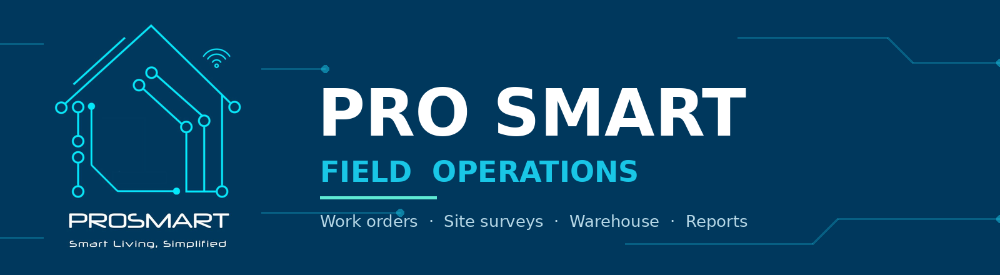
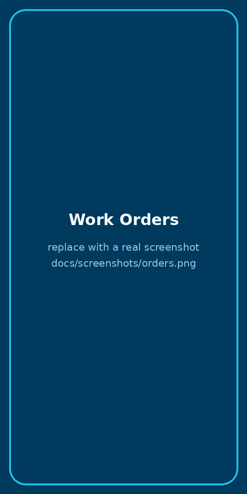
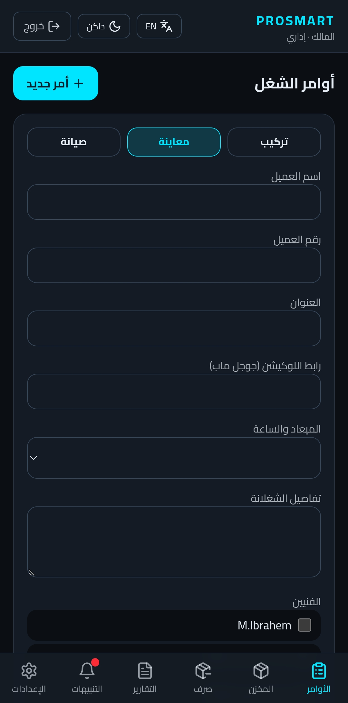
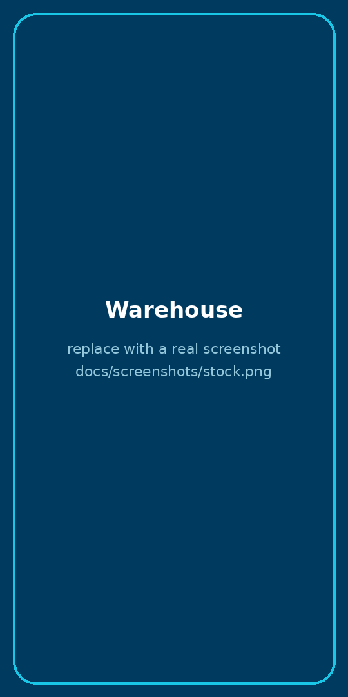

# برو سمارت — Pro Smart Field

**منصة إدارة أعمال التركيب الميداني: سمارت هوم، كاميرات مراقبة، إنتركم، وشبكات.**

[🇬🇧 English version](README.md)

---

## © حقوق الملكية

**جميع الحقوق محفوظة © 2026 — MOHAMED IBRAHEM**

مشروع **Pro Smart Field** — بكوده وتصميمه وهيكل قاعدة بياناته وتوثيقه وكل ملحقاته — **صممه وطوّره بالكامل المطوّر MOHAMED IBRAHEM** (Pro Smart).

- ❌ **ممنوع** نسخ المشروع أو أي جزء منه أو إعادة توزيعه أو بيعه أو نشره.
- ❌ **ممنوع** التعديل عليه وتقديمه على إنه عملك.
- ❌ **ممنوع** حذف أو تغيير هذا الإشعار أو اسم المطوّر.
- ❌ **ممنوع** نسب المشروع أو ملكيته لأي شخص آخر بأي شكل.
- ✅ الاستخدام مسموح **بإذن كتابي** من المالك فقط.

أي استخدام أو نسخ أو نسب غير مصرّح به هو انتهاك لحقوق المطوّر وقد تتم المطالبة به قانونياً. راجع ملف [LICENSE](LICENSE). اسم وشعار **Pro Smart** علامات تجارية لصاحبها.

---

## 📖 نبذة تعريفية

**Pro Smart Field** تطبيق لإدارة العمل الميداني، اتعمل لشركة **Pro Smart** المتخصصة في تركيب أنظمة السمارت هوم وكاميرات المراقبة والإنتركم والشبكات في مصر.

بيستبدل الورق ورسايل الواتساب المتفرقة بسير شغل واحد منظم: المكتب بيعمل أمر الشغل، الفنيين بيوصلهم إشعار فوري ويسجلوا كل اللي عملوه في الموقع (صور، توقيع، أجهزة، أطوال كابلات)، أمين المخزن بيتابع كل صنف خارج أو راجع، والمالك بيشوف الصورة كاملة في التقارير.

> متصمم للموبايل أولاً — بيشتغل كتطبيق **أندرويد (APK)** وكموقع ويب، ومعاه وضع عدم الاتصال للأماكن ضعيفة الشبكة.

---

## 📸 صور من النظام

| أوامر الشغل | أمر جديد | المخزن | التقارير |
|:---:|:---:|:---:|:---:|
|  |  |  |  |

---

## ✨ المميزات

### 📋 أوامر الشغل
- 🛠️ **ثلاثة أنواع**: تركيب · معاينة · صيانة
- 👥 تعيين أكتر من فني، اختيار قائد الفريق، الميعاد، اسم العميل وتليفونه وعنوانه
- 🔔 إشعار فوري لكل فني متعيّن
- 📍 تسجيل "وصلت" و"انصرفت" في الموقع
- 🔗 أمر الصيانة ممكن يتربط بأمر سابق فتتملا بيانات العميل لوحدها
- 💬 زرار واتساب لتأكيد الميعاد مع العميل

### 🔍 المعاينة
- 🏠 ثلاثة أقسام: **سمارت هوم · كاميرات · شبكات**
- 🚪 إضافة غرف أو مناطق بأسماء وطوابق، واختيار الأجهزة من الكتالوج بالعدد
- 📡 نظام السمارت هوم بيتحدد **مرة واحدة للمعاينة**: **واي فاي 2.4** أو **زيجبي** (عدد الهابات) أو **لوحات KNX Style** (عدد اللوحات + الطول × العرض × العمق لكل لوحة)
- 🧮 **إجمالي تلقائي** في آخر كل قسم
- 📄 الإداري يراجع ويعدّل و**يصدّر PDF**

### 🗂️ كتالوج الأجهزة
- 📚 **91 جهاز** عربي وإنجليزي: تاتش سويتش من 1 إلى 4 خط، سمارت شاتر، حساسات تواجد وحركة، سمارت لوك، بلج، حساسات غاز ومياه، NVR، كاميرات 2MP إلى 8MP، كابلات (Cat6 / كواكس / كهرباء بالمتر)، هارد 1TB إلى 10TB، راوترات، أكسس بوينت، سويتشات، راكات
- ✏️ المالك يضيف ويعدّل ويحذف من **الإعدادات ← كتالوج أجهزة المعاينة**
- 🔐 صلاحية "إدارة كتالوج أجهزة المعاينة" تتدي لأي مستخدم

### 📦 المخزن
- ➕ زرار **"زوّد"** مع سجل كامل: مصدر التوريد (فاتورة / مورد / اسم الشغل) والرصيد قبل وبعد — الرصيد نفسه مفيش له تعديل يدوي
- 🕘 سجل التوريد: مين زوّد إيه ومن فين
- 📤 دورة: صرف ← تركيب ← مرتجع، والمرتجع لازم **يوافق عليه أمين المخزن**
- 📷 مسح الباركود والسيريال بكاميرا الموبايل
- 🗃️ فئات متداخلة (ماركة › نوع › موديل)

### 👷 الفنيين
- ✅ مهام لكل فني داخل الأمر الواحد، ولكل مهمة مكافأة بتتضاف بعد موافقة الإداري
- 📸 صور متعددة، توقيع العميل، IPs وباسوردات، أطوال الكابلات، علامة "فيه شغل متبقي"
- 📴 وضع عدم الاتصال — البيانات بتتحفظ وتتزامن لما الشبكة ترجع

### 🔐 صلاحيات المخزن وموافقة الصرف
- 👤 حساب **andro@prosmart.app** هو الوحيد اللي يقدر **يضيف / يعدّل / يحذف** في المخزن (محمي على مستوى الداتا بيز).
- 📝 أي إداري (أو أمين مخزن) بيعمل **طلب صرف**، والصرف مبيتخصمش من الرصيد إلا لما الحساب ده **يوافق**، وبيوصله إشعار بالطلب.

### 🚗 السائقين
- دور جديد **سائق**: الإداري بيعمل «مشوار» (سائق + فنيين + وجهة + ميعاد) والسائق بيشوفه ويضغط قبلت / في الطريق / تم، والفنيين بيوصلهم إشعار.

### 🧾 رأي وتوقيع العميل بالـ QR
- الفني بيعرض **QR** والعميل بيعمل سكان بموبايله، يكتب رأيه ويقيّم ويوقّع هناك (مفيش حاجة بتتكتب من موبايل الفني).
- الإداري بيشوف كل الآراء في تبويب **آراء العملاء** باسم العميل ورقم الأمر.

### 📊 التقارير والتصدير
- 🏆 مين أكتر فني بيخلّص أوامر، ومين أكتر واحد شغال في المواقع
- 📑 تصدير **Excel** و**PDF**
- ⏰ تذكيرات من المدير لأشخاص يتم اختيارهم

### 🌍 لغتين وثيمات
- 🔤 عربي (RTL) وإنجليزي (LTR) من الهيدر أو صفحة الدخول أو الإعدادات
- 🌗 وضع فاتح / داكن
- 🔄 **تحديث من جوه التطبيق** — بيكتشف النسخة الجديدة وبيركّبها فوق القديمة

---

## 🧰 التقنيات المستخدمة

| الطبقة | التقنية |
|---|---|
| الواجهة | React 18 · TypeScript · Vite · Tailwind CSS 4 |
| الباك إند | Supabase: PostgreSQL · Auth · Row-Level Security · Edge Functions |
| الموبايل | Capacitor 6 · Android |
| الإشعارات | Firebase Cloud Messaging |
| التصدير | ExcelJS · jsPDF |
| مسح الباركود | ZXing |
| النشر | GitHub Actions |

---

## 🚀 طريقة التثبيت

1. نزّل ملف **`ProSmart.apk`** من [**Releases ← latest**](https://github.com/dev-m-ibrahim/prosmart-field/releases/tag/latest).
2. افتحه على موبايل أندرويد واسمح بالتثبيت من المصدر لو طلب منك.
3. سجّل دخول بالحساب اللي عمله لك الإداري.
4. التحديثات: لما تنزل نسخة جديدة هيظهر شريط في أول الشاشة — اضغط **حدّث الآن**.

---

## 🧭 أقسام النظام

| الدور | الأقسام |
|---|---|
| 👑 **المالك / الإداري** | الأوامر · المخزن · صرف · التقارير · التنبيهات · الإعدادات (المستخدمين، الكتالوج، الفئات، الصلاحيات) |
| 🛠️ **الفني** | أوامري · تفاصيل الأمر والمعاينة · التنبيهات · الإعدادات |
| 📦 **أمين المخزن** | المخزن · صرف · موافقة المرتجعات · التنبيهات · الإعدادات |

---

## 📌 حالة المشروع والتحديثات

**الحالة:** 🟢 قيد التطوير النشط — مستخدم يومياً.

### آخر التحديثات
- ✅ أنواع الأوامر: تركيب / معاينة / صيانة
- ✅ المعاينة بأقسامها الثلاثة وإجمالي تلقائي
- ✅ نظام السمارت هوم على مستوى المعاينة: واي فاي 2.4 أو هابات زيجبي أو لوحات KNX Style بمقاس **كل** لوحة
- ✅ كتالوج 91 جهاز عربي/إنجليزي بيديره المالك
- ✅ زرار "زوّد" في المخزن مع مصدر التوريد والرصيد قبل وبعد
- ✅ واجهة عربي / إنجليزي

### قيد التنفيذ
- ⏳ ترجمة ملفات PDF والتنبيهات اللي بتتولد من قاعدة البيانات للإنجليزي

---

**© 2026 MOHAMED IBRAHEM — جميع الحقوق محفوظة. يُمنع النسخ أو نسب المشروع لغير صاحبه.**

*Smart Living, Simplified.*

