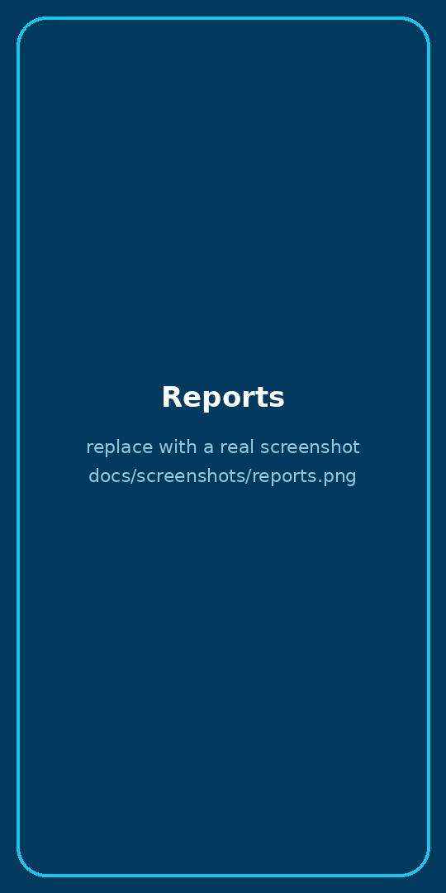

<div align="center">


<br/>


# Pro Smart Field — برو سمارت للتشغيل الميداني

**منصة إدارة أعمال التركيب الميداني: سمارت هوم · كاميرات مراقبة · إنتركم · شبكات.**
أوامر الشغل · المعاينات · المخزن · مهام الفنيين · التقارير — في تطبيق واحد بالعربي والإنجليزي.

[](#-التقنيات-المستخدمة)
[](#-حالة-المشروع-والتحديثات)
[](#-حقوق-الملكية)

[🇬🇧 English version](README.md)

</div>

<div dir="rtl">

---

## 📖 نبذة تعريفية

**Pro Smart Field** تطبيق احترافي لإدارة العمل الميداني، اتعمل لشركة **Pro Smart** المتخصصة في تركيب أنظمة السمارت هوم وكاميرات المراقبة والإنتركم والشبكات في مصر.

بيستبدل الورق ورسايل الواتساب المتفرقة بسير شغل واحد منظم: المكتب بيعمل أمر الشغل، الفنيين بيوصلهم إشعار فوري، بيسجلوا كل اللي عملوه في الموقع (صور، توقيع، أجهزة، أطوال كابلات)، أمين المخزن بيتابع كل صنف خارج أو راجع، والمالك بيشوف الصورة كاملة في التقارير.

> متصمم للموبايل أولاً — بيشتغل كتطبيق **أندرويد (APK)** وكموقع ويب، ومعاه وضع عدم الاتصال للأماكن ضعيفة الشبكة.

---

## 📸 صور من النظام

<div align="center">

| أوامر الشغل | المعاينة | المخزن | التقارير |
|:---:|:---:|:---:|:---:|
|  |  |  |  |

</div>

> 📌 استبدل الصور في [`docs/screenshots/`](docs/screenshots) بلقطات حقيقية من التطبيق بنفس أسماء الملفات.

---

## ✨ المميزات

### 📋 أوامر الشغل
- 🛠️ **ثلاثة أنواع**: تركيب · معاينة · صيانة
- 👥 تعيين أكتر من فني، اختيار قائد الفريق، الميعاد، اسم العميل وتليفونه وعنوانه
- 🔔 إشعار فوري لكل فني متعيّن
- 📍 تسجيل "وصلت" و"انصرفت" في الموقع
- 🔗 أمر الصيانة ممكن يتربط بأمر سابق فتتملا بيانات العميل لوحدها
- 💬 زرار واتساب لتأكيد الميعاد مع العميل

### 🔍 المعاينة
- 🏠 ثلاثة أقسام: **سمارت هوم · كاميرات · شبكات**
- 🚪 إضافة غرف أو مناطق بأسماء وطوابق، واختيار الأجهزة من الكتالوج بالعدد
- 📡 نظام السمارت هوم بيتحدد **مرة واحدة للمعاينة**: **واي فاي 2.4** أو **زيجبي** (عدد الهابات) أو **لوحات KNX Style** (عدد اللوحات + الطول × العرض × العمق لكل لوحة)
- 🧮 **إجمالي تلقائي** في آخر كل قسم
- 📄 الإداري يراجع ويعدّل و**يصدّر PDF**

### 🗂️ كتالوج الأجهزة
- 📚 **91 جهاز** عربي وإنجليزي: تاتش سويتش من 1 إلى 4 خط، سمارت شاتر، حساسات تواجد وحركة، سمارت لوك، بلج، حساسات غاز ومياه، NVR، كاميرات 2MP إلى 8MP، كابلات (Cat6 / كواكس / كهرباء بالمتر)، هارد 1TB إلى 10TB، راوترات، أكسس بوينت، سويتشات، راكات
- ✏️ المالك يضيف ويعدّل ويحذف من **الإعدادات ← كتالوج أجهزة المعاينة**
- 🔐 صلاحية "إدارة كتالوج أجهزة المعاينة" تتدي لأي مستخدم

### 📦 المخزن
- ➕ زرار **"زوّد"** مع سجل كامل: مصدر التوريد (فاتورة / مورد / اسم الشغل) والرصيد قبل وبعد — الرصيد نفسه مفيش له تعديل يدوي
- 🕘 سجل التوريد: مين زوّد إيه ومن فين
- 📤 دورة: صرف ← تركيب ← مرتجع، والمرتجع لازم **يوافق عليه أمين المخزن**
- 📷 مسح الباركود والسيريال بكاميرا الموبايل
- 🗃️ فئات متداخلة (ماركة › نوع › موديل)

### 👷 الفنيين
- ✅ مهام لكل فني داخل الأمر الواحد، ولكل مهمة مكافأة بتتضاف بعد موافقة الإداري
- 📸 صور متعددة، توقيع العميل، IPs وباسوردات، أطوال الكابلات، علامة "فيه شغل متبقي"
- 📴 وضع عدم الاتصال — البيانات بتتحفظ وتتزامن لما الشبكة ترجع

### 📊 التقارير والتصدير
- 🏆 مين أكتر فني بيخلّص أوامر، ومين أكتر واحد شغال في المواقع
- 📑 تصدير **Excel** و**PDF**
- ⏰ تذكيرات من المدير لأشخاص يتم اختيارهم

### 🌍 لغتين وثيمات
- 🔤 عربي (RTL) وإنجليزي (LTR) من الهيدر أو صفحة الدخول أو الإعدادات
- 🌗 وضع فاتح / داكن
- 🔄 **تحديث من جوه التطبيق** — بيكتشف النسخة الجديدة وبيركّبها فوق القديمة

---

## 🧰 التقنيات المستخدمة

| الطبقة | التقنية |
|---|---|
| الواجهة | React 18 · TypeScript · Vite · Tailwind CSS 4 |
| الباك إند | Supabase: PostgreSQL · Auth · Row-Level Security · Edge Functions · pg_cron |
| الموبايل | Capacitor 6 · Android |
| الإشعارات | Firebase Cloud Messaging |
| التصدير | ExcelJS · jsPDF · html2canvas |
| مسح الباركود | ZXing |
| وضع عدم الاتصال | IndexedDB (idb-keyval) |
| النشر | GitHub Actions ← APK في Releases · GitHub Pages للموقع |

---

## 🚀 طريقة التثبيت والتشغيل

### 1) قاعدة البيانات (Supabase ← SQL Editor، بالترتيب)

| الملف | الغرض |
|---|---|
| `sql/step7.sql` | الجداول الأساسية (لو لسه ما اتشغلش) |
| `sql/step8.sql` | الإشعارات + صرف المخزن |
| `sql/step10.sql` | صلاحيات أمين المخزن + تعديل/حذف الأوامر |
| `sql/step11.sql` | المالك + استلام الأمر + التذكيرات (pg_cron) + سجل العمليات |
| `sql/step12.sql` | منطق المخزن (صرف ← تركيب ← مرتجع) + لقب مهندس |
| `sql/step13.sql` | موافقة أمين المخزن على المرتجعات + زر واتساب |
| `sql/step14.sql` | الفئات المتداخلة (بينقل القديمة لوحده) |
| `sql/step15.sql` | أنواع الأوامر + كتالوج المعاينة + المعاينات + سجل التوريد |

### 2) تشغيل الإشعارات (مرة واحدة)
1. **Firebase**: أنشئ مشروع ← أضف تطبيق Android باسم الحزمة `com.prosmart.field` ← نزّل `google-services.json`.
2. **GitHub**: *Settings ← Secrets and variables ← Actions* ← سر جديد اسمه `GOOGLE_SERVICES_JSON` وقيمته محتوى الملف.
3. **Firebase**: *Project settings ← Service accounts* ← Generate new private key.
4. **Supabase ← Edge Functions**: أنشئ `send-push` من `supabase/functions/send-push/index.ts`، وأضف الأسرار `FIREBASE_SERVICE_ACCOUNT` (ملف المفتاح) و`WEBHOOK_SECRET` (أي كلمة سر طويلة عشوائية).
5. حط نفس `WEBHOOK_SECRET` في `sql/step9_push_webhook.sql` وشغّله.

### 3) بناء الـ APK
أي Push على `main` (أو *Actions ← Build Android APK ← Run workflow*) بيبني الـ APK وينشره في **Releases ← latest ← `ProSmart.apk`**.
الـ APK دايماً متوقّع بالمفتاح الثابت في `ci/debug.keystore`، فكل نسخة جديدة بتتركّب **فوق** القديمة.

> ⚠️ **ما تمسحش ولا تعيد إنشاء `ci/debug.keystore`.** أي مفتاح مختلف بيخلي أندرويد يرفض التحديث برسالة *"App not installed as package conflicts with an existing package"*. لو حصلت مرة (النسخة المركّبة متوقّعة بمفتاح قديم) امسح التطبيق وركّب آخر APK، وبعدها التحديثات بتشتغل عادي.

### 4) الموقع (GitHub Pages)
*Settings ← Pages ← Source: GitHub Actions*. كل Push على main بينشر الموقع.

### 5) تشغيل محلي
```bash
npm install
npm run dev
```

### 6) إعادة تعيين باسورد مستخدم (للمالك بس)
انشر الـ Edge Function باسم `admin-reset-password` من `supabase/functions/admin-reset-password/index.ts`، وبعدها هتلاقي زرار "باسورد" جنب كل مستخدم في *الإعدادات ← المستخدمين*.

---

## 🧭 أقسام النظام

| الدور | الأقسام |
|---|---|
| 👑 **المالك / الإداري** | الأوامر · المخزن · صرف · التقارير · التنبيهات · الإعدادات (المستخدمين، الكتالوج، الفئات، الصلاحيات) |
| 🛠️ **الفني** | أوامري · تفاصيل الأمر والمعاينة · التنبيهات · الإعدادات |
| 📦 **أمين المخزن** | المخزن · صرف · موافقة المرتجعات · التنبيهات · الإعدادات |

---

## 📌 حالة المشروع والتحديثات

**الحالة:** 🟢 قيد التطوير النشط — مستخدم يومياً.

### آخر التحديثات
- ✅ أنواع الأوامر: تركيب / معاينة / صيانة
- ✅ المعاينة بأقسامها الثلاثة وإجمالي تلقائي
- ✅ نظام السمارت هوم على مستوى المعاينة: واي فاي 2.4 أو هابات زيجبي أو لوحات KNX Style بمقاس **كل** لوحة
- ✅ كتالوج 91 جهاز عربي/إنجليزي بيديره المالك
- ✅ زرار "زوّد" في المخزن مع مصدر التوريد والرصيد قبل وبعد
- ✅ واجهة عربي / إنجليزي
- ✅ فحص توقيع الـ APK في CI عشان التحديثات تتركّب فوق القديمة دايماً

### قيد التنفيذ
- ⏳ ترجمة ملفات PDF والتنبيهات اللي بتتولد من قاعدة البيانات للإنجليزي

---

## © حقوق الملكية

**جميع الحقوق محفوظة © 2026 — MOHAMED IBRAHEM.**

مشروع **Pro Smart Field** — بكودِه وتصميمه وهيكل قاعدة بياناته وتوثيقه وكل ملحقاته — **صممه وطوّره بالكامل المطوّر MOHAMED IBRAHEM** (Pro Smart).

- ❌ **ممنوع** نسخ المشروع أو أي جزء منه أو إعادة توزيعه أو بيعه أو نشره.
- ❌ **ممنوع** التعديل عليه وتقديمه على إنه عملك.
- ❌ **ممنوع** حذف أو تغيير هذا الإشعار أو اسم المطوّر.
- ❌ **ممنوع** نسب المشروع أو ملكيته لأي شخص آخر بأي شكل.
- ✅ الاستخدام مسموح **بإذن كتابي** من المالك فقط.

أي استخدام أو نسخ أو نسب غير مصرّح به هو انتهاك لحقوق المطوّر وقد تتم المطالبة به قانونياً. راجع ملف [LICENSE](LICENSE).

اسم وشعار **Pro Smart** علامات تجارية لصاحبها.

</div>

<div align="center">

**تم التطوير بكل ❤️ بواسطة MOHAMED IBRAHEM — Pro Smart، مصر**

*Smart Living, Simplified.*

</div>
