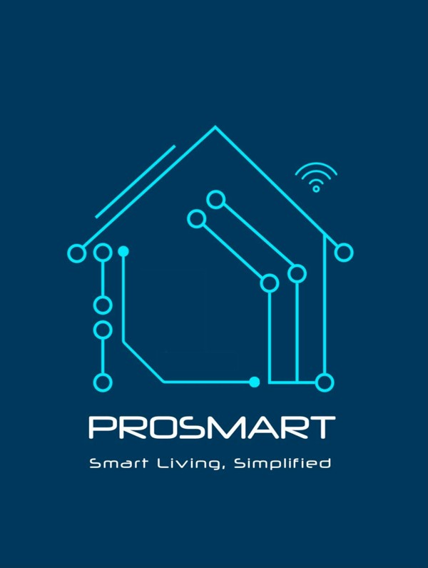
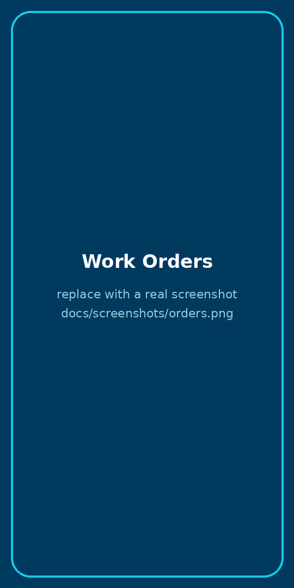
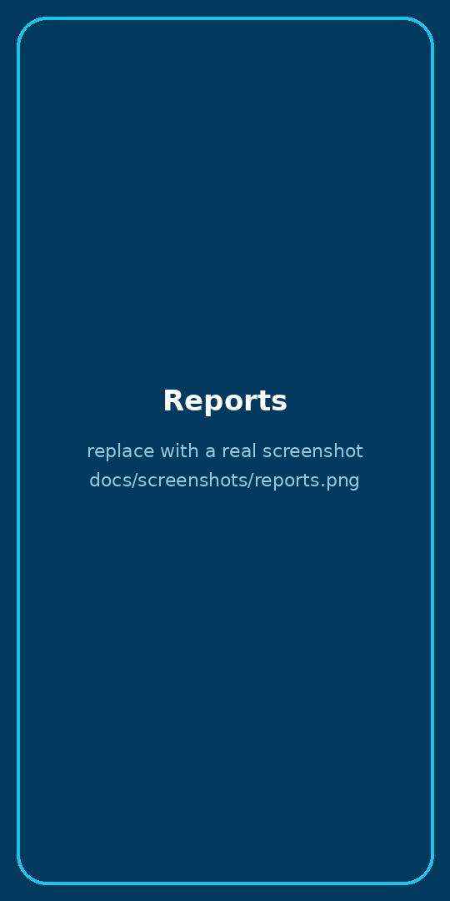

<div align="center">


<br/>



# Pro Smart Field

**Field-operations platform for smart-home, CCTV, intercom & network installation teams.**
Work orders · Site surveys · Warehouse · Technician tasks · Reports — in one bilingual app (Arabic / English).

[](#-tech-stack)
[](#-project-status--updates)
[](#-copyright--ownership)
[](#-features)

[🇪🇬 النسخة العربية](README.ar.md)

</div>

---

## 📖 About

**Pro Smart Field** is a production field-service app built for **Pro Smart**, a smart-home installation company in Egypt that installs smart-home systems, security cameras, intercoms and networks.

It replaces paper notes and WhatsApp chaos with one organised workflow: the office creates a work order, technicians get notified, record everything they do on site (photos, signatures, devices, cable lengths), the storekeeper tracks every item that leaves or returns to the warehouse, and the owner sees the whole picture in reports.

> Designed mobile-first for technicians on the road — works as an installable **Android app (APK)** and as a **web app**, with offline support for poor-signal sites.

---

## 📸 Screenshots

<div align="center">

| Work orders | Site survey | Warehouse | Reports |
|:---:|:---:|:---:|:---:|
|  |  |  |  |

</div>

> 📌 Replace the files in [`docs/screenshots/`](docs/screenshots) with real screenshots using the same file names.

---

## ✨ Features

### 📋 Work orders
- 🛠️ **Three order types** — Installation · Site survey · Maintenance
- 👥 Assign several technicians, pick a team leader, set date & time, client name / phone / address
- 🔔 Instant push notification to every assigned technician
- 📍 "Arrived" / "Departed" time stamps recorded on site
- 🔗 Maintenance orders can be **linked to a previous order** (client data auto-filled)
- 💬 WhatsApp button to confirm the appointment with the client

### 🔍 Site survey (معاينة)
- 🏠 Three sections: **Smart Home · CCTV · Network**
- 🚪 Add rooms / areas with names and floors, pick devices from the catalog with quantities
- 📡 Smart-home system chosen once per survey: **Wi-Fi 2.4 GHz**, **Zigbee** (number of hubs) or **KNX-style panels** (number of panels + length × width × depth for each panel)
- 🧮 Automatic **totals per section**
- 📄 Admin can review, edit and **export the survey as PDF**

### 🗂️ Device catalog
- 📚 **91 bilingual devices** out of the box — touch switches (1–4 gang), smart shutters, presence & motion sensors, smart locks, plugs, gas & water sensors, NVRs, 2 MP–8 MP cameras, cables (Cat6 / coax / power, per metre), 1 TB–10 TB hard drives, routers, access points, switches and racks
- ✏️ Owner adds, edits and deletes devices from **Settings → Survey device catalog**
- 🔐 Owner can grant any user the "manage survey catalog" permission

### 📦 Warehouse
- ➕ **Top-up** button with full audit trail: source (invoice / supplier / job name), balance before and after — balances can never be edited by hand
- 🕘 Supply history: who added what, and from where
- 📤 Issue → install → return flow; returns need **storekeeper approval** before going back to stock
- 📷 Barcode / serial scanning with the phone camera
- 🗃️ Nested categories (Brand › Type › Model)

### 👷 Technicians
- ✅ Per-technician tasks inside one order, each with its own bonus (added after admin approval)
- 📸 Multiple site photos, client signature, IPs & passwords, cable lengths, follow-up flag
- 📴 Offline mode — data is queued and synced when the signal returns

### 📊 Reports & exports
- 🏆 Who completes the most orders · who works most on sites
- 📑 Export to **Excel** and **PDF**
- ⏰ Manager reminders delivered to selected people

### 🌍 Bilingual & themed
- 🔤 Arabic (RTL) and English (LTR) — switch from the header, the login page or Settings
- 🌗 Light / dark theme
- 🔄 **In-app updates** — the app detects a new release and installs it over the old one

---

## 🧰 Tech stack

| Layer | Technology |
|---|---|
| UI |     |
| Backend |  PostgreSQL · Auth · Row-Level Security · Edge Functions · pg_cron |
| Mobile |   |
| Notifications | Firebase Cloud Messaging |
| Exports | ExcelJS · jsPDF · html2canvas |
| Scanning | ZXing |
| Offline | IndexedDB (idb-keyval) |
| CI / CD |  → APK in Releases · GitHub Pages for the web app |

---

## 🚀 Installation & setup

### 1) Database (Supabase → SQL Editor, in order)

| File | Purpose |
|---|---|
| `sql/step7.sql` | Base schema (if not already applied) |
| `sql/step8.sql` | Notifications + warehouse issue |
| `sql/step10.sql` | Storekeeper permissions, order edit/delete |
| `sql/step11.sql` | Owner role, order receipt, reminders (pg_cron), audit log |
| `sql/step12.sql` | Warehouse logic (issue → install → return), engineer title |
| `sql/step13.sql` | Return approval by storekeeper + WhatsApp button |
| `sql/step14.sql` | Nested categories (migrates old ones automatically) |
| `sql/step15.sql` | Order types, survey catalog, surveys, supply log |

### 2) Push notifications (one time)
1. **Firebase** → create a project → add an Android app with package `com.prosmart.field` → download `google-services.json`.
2. **GitHub** → *Settings → Secrets and variables → Actions* → new secret `GOOGLE_SERVICES_JSON` with the file content.
3. **Firebase** → *Project settings → Service accounts* → generate a private key.
4. **Supabase → Edge Functions** → create `send-push` from `supabase/functions/send-push/index.ts`, then add secrets `FIREBASE_SERVICE_ACCOUNT` (the key file) and `WEBHOOK_SECRET` (any long random string).
5. Put the same `WEBHOOK_SECRET` in `sql/step9_push_webhook.sql` and run it.

### 3) Android APK
Every push to `main` (or *Actions → Build Android APK → Run workflow*) builds the APK and publishes it at **Releases → latest → `ProSmart.apk`**.
The APK is always signed with the fixed key in `ci/debug.keystore`, so every new build installs **over** the old one.

> ⚠️ **Do not delete or regenerate `ci/debug.keystore`.** A different key makes Android reject updates with *"App not installed as package conflicts with an existing package"*. If that happens once (APK signed with an older key), uninstall the app and install the latest APK; updates work normally afterwards.

### 4) Web app (GitHub Pages)
*Settings → Pages → Source: GitHub Actions*. Every push to `main` deploys the site.

### 5) Run locally
```bash
npm install
npm run dev
```

### 6) Reset a user's password (owner only)
Deploy the Edge Function `admin-reset-password` from `supabase/functions/admin-reset-password/index.ts`. A **Password** button then appears next to each user in *Settings → Users*.

---

## 🧭 System sections

| Role | Sections |
|---|---|
| 👑 **Owner / Admin** | Work orders · Warehouse · Issue · Reports · Alerts · Settings (users, catalog, categories, permissions) |
| 🛠️ **Technician** | My orders · Order details & survey · Alerts · Settings |
| 📦 **Storekeeper** | Warehouse · Issue · Returns approval · Alerts · Settings |

```
src/
├─ pages/        admin · technician · storekeeper screens
├─ components/   SurveyForm · SurveyView · Scanner · Photos · UpdateBanner …
├─ lib/          survey · export · offline · push · update · supabase
├─ i18n/         Arabic ⇄ English
sql/             database migrations (step7 → step15)
supabase/        Edge Functions
ci/              APK signing key + Android patch scripts
.github/         build & deploy workflows
```

---

## 📌 Project status & updates

**Status:** 🟢 Active development — in daily use.

### Latest
- ✅ Order types: Installation / Site survey / Maintenance
- ✅ Site survey with Smart Home · CCTV · Network sections and automatic totals
- ✅ Smart-home setup per survey: Wi-Fi 2.4, Zigbee hubs, or KNX-style panels with the size of **each** panel
- ✅ Bilingual device catalog (91 devices) managed by the owner
- ✅ Warehouse top-up with supply source and before / after balance
- ✅ Arabic / English interface
- ✅ Signing-key guard in CI so updates always install over the old version

### Planned
- ⏳ Translate the remaining database-generated PDFs and alerts to English

---

## © Copyright & ownership

**Copyright © 2026 MOHAMED IBRAHEM. All rights reserved.**

Pro Smart Field — its source code, design, database schema, logo usage, documentation and every related asset — was **designed and developed solely by MOHAMED IBRAHEM** (Pro Smart).

- ❌ You may **not** copy, redistribute, resell, sublicense, or publish this project or any part of it.
- ❌ You may **not** modify it and present it as your own work.
- ❌ You may **not** remove or alter this notice or the developer attribution.
- ❌ You may **not** claim authorship or ownership of this project in any form.
- ✅ Use is allowed only with the **written permission** of the owner.

Any unauthorised use, copying or false attribution is a violation of the author's rights and may be pursued legally. See [LICENSE](LICENSE).

The **Pro Smart** name and logo are trademarks of their owner.

<div align="center">

**Developed with ❤️ by MOHAMED IBRAHEM — Pro Smart, Egypt**

*Smart Living, Simplified.*

</div>
