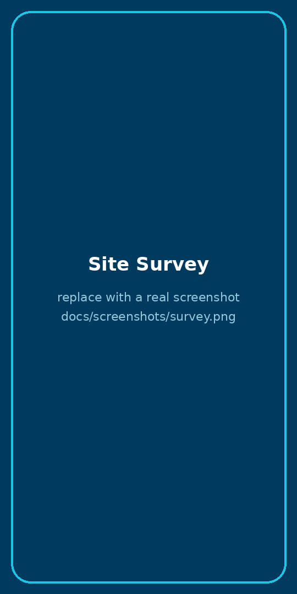
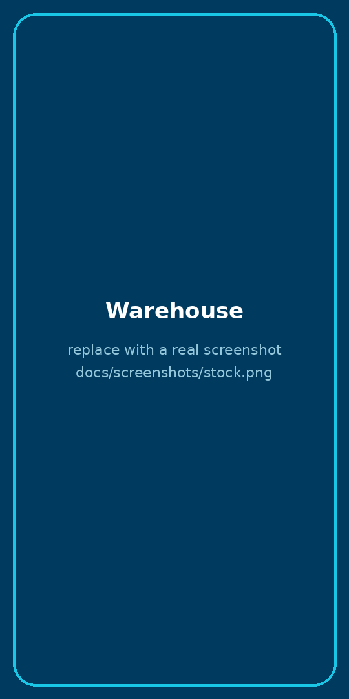

# Pro Smart Field

**Field-operations platform for smart-home, CCTV, intercom & network installation teams.**

[🇪🇬 النسخة العربية](README.ar.md)

---

## © Copyright & Ownership

**Copyright © 2026 MOHAMED IBRAHEM — All rights reserved.**

**Pro Smart Field** — its source code, design, database schema, documentation and every related asset — was **designed and developed solely by MOHAMED IBRAHEM** (Pro Smart).

- ❌ Copying, redistributing, reselling or publishing this project or any part of it is **prohibited**.
- ❌ Modifying it and presenting it as your own work is **prohibited**.
- ❌ Removing or altering this notice or the developer attribution is **prohibited**.
- ❌ Attributing the project or its ownership to anyone else, in any form, is **prohibited**.
- ✅ Use is allowed only with the **written permission** of the owner.

Any unauthorised use, copying or false attribution is a violation of the author's rights and may be pursued legally. See [LICENSE](LICENSE). The **Pro Smart** name and logo are trademarks of their owner.

---

## 📖 About

**Pro Smart Field** is a field-service app built for **Pro Smart**, a smart-home installation company in Egypt that installs smart-home systems, security cameras, intercoms and networks.

It replaces paper notes and scattered WhatsApp messages with one organised workflow: the office creates a work order, technicians are notified instantly and record everything they do on site (photos, signatures, devices, cable lengths), the storekeeper tracks every item that leaves or returns to the warehouse, and the owner sees the whole picture in the reports.

> Designed mobile-first for technicians on the road — works as an installable **Android app (APK)** and as a **web app**, with offline support for poor-signal sites.

---

## 📸 Screenshots

| Work orders | Site survey | Warehouse | Reports |
|:---:|:---:|:---:|:---:|
|  |  |  |  |

---

## ✨ Features

### 📋 Work orders
- 🛠️ **Three order types** — Installation · Site survey · Maintenance
- 👥 Assign several technicians, pick a team leader, set date & time, client name / phone / address
- 🔔 Instant push notification to every assigned technician
- 📍 "Arrived" / "Departed" time stamps recorded on site
- 🔗 Maintenance orders can be **linked to a previous order** (client data auto-filled)
- 💬 WhatsApp button to confirm the appointment with the client

### 🔍 Site survey
- 🏠 Three sections: **Smart Home · CCTV · Network**
- 🚪 Add rooms / areas with names and floors, pick devices from the catalog with quantities
- 📡 Smart-home system chosen once per survey: **Wi-Fi 2.4 GHz**, **Zigbee** (number of hubs) or **KNX-style panels** (number of panels + length × width × depth for each panel)
- 🧮 Automatic **totals per section**
- 📄 Admin can review, edit and **export the survey as PDF**

### 🗂️ Device catalog
- 📚 **91 bilingual devices** out of the box — touch switches (1–4 gang), smart shutters, presence & motion sensors, smart locks, plugs, gas & water sensors, NVRs, 2 MP–8 MP cameras, cables (Cat6 / coax / power, per metre), 1 TB–10 TB hard drives, routers, access points, switches and racks
- ✏️ The owner adds, edits and deletes devices from **Settings → Survey device catalog**
- 🔐 The owner can grant any user the "manage survey catalog" permission

### 📦 Warehouse
- ➕ **Top-up** button with a full audit trail: source (invoice / supplier / job name), balance before and after — balances can never be edited by hand
- 🕘 Supply history: who added what, and from where
- 📤 Issue → install → return flow; returns need **storekeeper approval** before going back to stock
- 📷 Barcode / serial scanning with the phone camera
- 🗃️ Nested categories (Brand › Type › Model)

### 👷 Technicians
- ✅ Per-technician tasks inside one order, each with its own bonus (added after admin approval)
- 📸 Multiple site photos, client signature, IPs & passwords, cable lengths, follow-up flag
- 📴 Offline mode — data is queued and synced when the signal returns

### 📊 Reports & exports
- 🏆 Who completes the most orders · who works most on sites
- 📑 Export to **Excel** and **PDF**
- ⏰ Manager reminders delivered to selected people

### 🌍 Bilingual & themed
- 🔤 Arabic (RTL) and English (LTR) — switch from the header, the login page or Settings
- 🌗 Light / dark theme
- 🔄 **In-app updates** — the app detects a new release and installs it over the old one

---

## 🧰 Tech stack

| Layer | Technology |
|---|---|
| UI |     |
| Backend |  PostgreSQL · Auth · Row-Level Security · Edge Functions |
| Mobile |   |
| Notifications | Firebase Cloud Messaging |
| Exports | ExcelJS · jsPDF |
| Scanning | ZXing |
| CI / CD |  |

---

## 🚀 Installation

1. Download **`ProSmart.apk`** from [**Releases → latest**](https://github.com/dev-m-ibrahim/prosmart-field/releases/tag/latest).
2. Open it on your Android phone and allow installation from this source if asked.
3. Sign in with the account created for you by the admin.
4. Updates: when a new version is available, a banner appears at the top — tap **Update now**.

---

## 🧭 System sections

| Role | Sections |
|---|---|
| 👑 **Owner / Admin** | Work orders · Warehouse · Issue · Reports · Alerts · Settings (users, catalog, categories, permissions) |
| 🛠️ **Technician** | My orders · Order details & survey · Alerts · Settings |
| 📦 **Storekeeper** | Warehouse · Issue · Returns approval · Alerts · Settings |

---

## 📌 Project status & updates

**Status:** 🟢 Active development — in daily use.

### Latest
- ✅ Order types: Installation / Site survey / Maintenance
- ✅ Site survey with Smart Home · CCTV · Network sections and automatic totals
- ✅ Smart-home setup per survey: Wi-Fi 2.4, Zigbee hubs, or KNX-style panels with the size of **each** panel
- ✅ Bilingual device catalog (91 devices) managed by the owner
- ✅ Warehouse top-up with supply source and before / after balance
- ✅ Arabic / English interface

### Planned
- ⏳ Translate the remaining database-generated PDFs and alerts to English

---

**© 2026 MOHAMED IBRAHEM — All rights reserved. Unauthorised copying or attribution to others is prohibited.**

*Smart Living, Simplified.*

